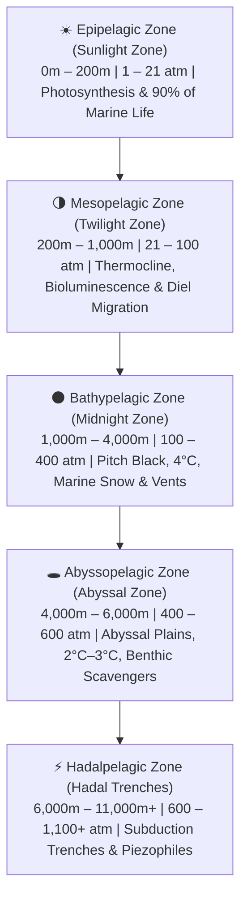

# Abyssal Descent: Scientific Reference & Verified Marine Data

> [!NOTE]
> All biological facts, depth ranges, pressure metrics, and physiological adaptations in the **Abyssal Descent** website are grounded in peer-reviewed oceanographic data from the **National Oceanic and Atmospheric Administration (NOAA)**, **Monterey Bay Aquarium Research Institute (MBARI)**, **Woods Hole Oceanographic Institution (WHOI)**, and the **Smithsonian Ocean Portal**.

---

## 1. The Five Pelagic Ocean Zones (NOAA Classification)

| Pelagic Zone | Depth Range (m / ft) | Light Penetration | Temp Range | Hydrostatic Pressure | Primary Source |
| :--- | :--- | :--- | :--- | :--- | :--- |
| **Epipelagic (Sunlight)** | 0 – 200 m (0 – 660 ft) | Photic (100% to 1%) | 15°C – 26°C | 1 – 21 atm | NOAA / WHOI |
| **Mesopelagic (Twilight)** | 200 – 1,000 m (660 – 3,300 ft) | Dysphotic (<1% to 0%) | 4°C – 15°C | 21 – 100 atm | NOAA / MBARI |
| **Bathypelagic (Midnight)** | 1,000 – 4,000 m (3,300 – 13,100 ft) | Aphotic (0% sunlight) | ~4°C (39°F) | 100 – 400 atm | NOAA / WHOI |
| **Abyssopelagic (Abyss)** | 4,000 – 6,000 m (13,100 – 19,685 ft) | Aphotic (0% sunlight) | 2°C – 3°C | 400 – 600 atm | NOAA / WHOI |
| **Hadalpelagic (Trenches)** | 6,000 – 11,000+ m (19,685 – 36,000+ ft) | Aphotic (0% sunlight) | 1°C – 2.5°C | 600 – 1,100+ atm | NOAA / WHOI |

---

## 2. Verified Species Roster by Depth

### Epipelagic Zone (0m – 200m)
1. **Bottlenose Dolphin (*Tursiops truncatus*) — ~45m**
   - **Fact:** Routinely forages in surface waters down to 45–150 meters using biological sonar (echolocation) clicks produced by nasal air sacs and focused through the lipid-rich "melon" in its forehead.
   - **Source:** NOAA Fisheries / Smithsonian Ocean
2. **Green Sea Turtle (*Chelonia mydas*) — ~120m**
   - **Fact:** The only strictly herbivorous adult sea turtle, grazing on seagrass meadows. Slows its heart rate to as low as one beat every several minutes to conserve oxygen during dives.
   - **Source:** NOAA Fisheries
3. **Great Hammerhead Shark (*Sphyrna mokarran*) — ~180m**
   - **Fact:** Its wide cephalofoil (hammer-shaped head) provides 360-degree vertical stereoscopic vision and houses thousands of *ampullae of Lorenzini* electroreceptors to detect stingrays buried beneath sand.
   - **Source:** Smithsonian Ocean / Florida Museum of Natural History

### Mesopelagic Zone (200m – 1,000m)
4. **Pacific Lanternfish (*Myctophidae*) — ~380m**
   - **Fact:** Accounts for up to 65% of all deep-sea fish biomass. Performs the *Diel Vertical Migration* nightly and uses ventral photophores for **counter-illumination**, matching downwelling twilight to erase its silhouette.
   - **Source:** Woods Hole Oceanographic Institution (WHOI) / NOAA
5. **Giant Siphonophore (*Praya dubia*) — ~520m**
   - **Fact:** Not a single animal, but a colonial organism composed of thousands of genetically identical clones (*zooids*) specialized for propulsion, feeding, or reproduction. Reaching up to 40 meters (130 ft), it is longer than a blue whale.
   - **Source:** MBARI
6. **Bloodybelly Comb Jelly (*Lampocteis cruentiventer*) — ~650m**
   - **Fact:** Discovered and named by MBARI scientists. Its crimson stomach appears pitch-black at depth because red wavelengths of light are absorbed in the upper ocean, concealing glowing prey it has just swallowed. Its 8 rows of cilia diffract light into shimmering rainbows.
   - **Source:** MBARI / Monterey Bay Aquarium
7. **Barreleye Fish (*Macropinna microstoma*) — ~720m**
   - **Fact:** Filmed alive by MBARI ROVs, it features a completely **transparent, fluid-filled dome head**. Its glowing green tubular eyes sit inside the transparent skull pointing upward to spot silhouettes, rotating forward when feeding on siphonophore prey.
   - **Source:** MBARI
8. **Vampire Squid (*Vampyroteuthis infernalis*) — ~850m**
   - **Fact:** Neither a true squid nor an octopus, this phylogenetic relic thrives in the **Oxygen Minimum Zone** (OMZ). Rather than hunting live prey, it deploys two retractable sticky filaments to harvest sinking **marine snow** (detritus) and ejects glowing blue bioluminescent mucus from its arm tips instead of black ink.
   - **Source:** MBARI

### Bathypelagic Zone (1,000m – 4,000m)
9. **Giant Squid (*Architeuthis dux*) — ~1,150m**
   - **Fact:** Possesses the largest eyes in the animal kingdom—up to 25–30 cm (10–12 inches) in diameter—evolved specifically to detect the faint bioluminescent wakes disturbed by approaching sperm whales in pitch darkness.
   - **Source:** Smithsonian Institution / NOAA
10. **Sperm Whale (*Physeter macrocephalus*) — ~1,650m**
    - **Fact:** The largest toothed predator on Earth plunges over 1,000–2,000 meters on 60–90 minute dives. Its collapsible ribcage and myoglobin-packed muscles prevent decompression sickness while hunting giant squid with 230-decibel sonar clicks.
    - **Source:** WHOI / Smithsonian Ocean
11. **Black Seadevil Anglerfish (*Melanocetus johnsonii*) — ~2,100m**
    - **Fact:** Females wield a modified dorsal spine (*esca*) packed with symbiotic bioluminescent bacteria (*Vibrio*) as a lure. Their skin is "ultra-black," absorbing >99.5% of incident light so their own lure does not reveal them.
    - **Source:** MBARI / Smithsonian National Museum of Natural History
12. **Giant Tube Worm (*Riftia pachyptila*) — ~2,500m**
    - **Fact:** Anchored around 400°C hydrothermal black smokers, adults have **no mouth, gut, or digestive tract**. Their crimson hemoglobin plumes absorb toxic hydrogen sulfide ($H_2S$) to feed billions of internal endosymbiotic bacteria (*trophosome*) via **chemosynthesis**.
    - **Source:** WHOI / NOAA Ocean Exploration
13. **Scaly-Foot Gastropod / Volcano Snail (*Chrysomallon squamiferum*) — ~2,780m**
    - **Fact:** Endemic to Indian Ocean hydrothermal vents, it is the only known extant animal to incorporate **iron sulfides (pyrite and greigite)** directly into its 3-layered shell and overlapping foot scales—making its armor literally magnetic.
    - **Source:** Smithsonian / IUCN / National Center for Biotechnology Information (NCBI)
14. **Cuvier's Beaked Whale (*Ziphius cavirostris*) — ~2,992m**
    - **Fact:** Holds the **verified world record for the deepest dive by any air-breathing mammal** at **2,992 meters (9,816 feet)** and the longest mammalian dive duration at **222 minutes (3.7 hours)**, tracked via acoustic tags.
    - **Source:** Woods Hole Oceanographic Institution (WHOI) / Cascadia Research Collective
15. **Atolla Crown Jellyfish (*Atolla wyvillei*) — ~3,400m**
    - **Fact:** Known as the **"Burglar Alarm Jellyfish."** When attacked, it triggers a propagating ring of blue bioluminescent flashes around its scarlet bell to attract an even larger apex predator to attack its attacker.
    - **Source:** MBARI / NOAA
16. **Dumbo Octopus (*Grimpoteuthis*) — ~3,850m**
    - **Fact:** The deepest-living genus of all known octopuses, named for the two ear-like muscular fins projecting from its mantle. Lacking an ink sac (useless in total darkness), it swallows benthic worms and crustaceans whole.
    - **Source:** NOAA Ocean Exploration / WHOI

### Abyssopelagic Zone (4,000m – 6,000m)
17. **Abyssal Sea Pig (*Scotoplanes globosa*) — ~4,600m**
    - **Fact:** A translucent, plump deep-sea holothurian (sea cucumber) that walks across the abyssal plain on hydraulic, water-inflated tube feet, vacuuming organic microbes from sinking marine snow and whale falls.
    - **Source:** MBARI
18. **Tripod Fish (*Bathypterois grallator*) — ~5,200m**
    - **Fact:** Perches motionless up to one meter above the abyssal ooze on three elongated, stiffened fin rays (two pelvic, one caudal). Eyeless in effect, it faces into the current and uses its pectoral fins like tactile antennas to snatch planktonic crustaceans.
    - **Source:** NOAA / Woods Hole Oceanographic Institution

### Hadalpelagic Zone (6,000m – 11,000m+)
19. **Supergiant Amphipod (*Alicella gigantea*) — ~7,200m**
    - **Fact:** A striking case of **abyssal/hadal gigantism**: while typical amphipods are under 1 cm, *Alicella gigantea* grows up to **34 cm (13.4 inches)** long and scavenges across depths down to nearly 9,000 meters.
    - **Source:** University of Western Australia / NOAA
20. **Mariana Snailfish (*Pseudoliparis swirei*) — ~8,178m**
    - **Fact:** One of the deepest vertebrate fishes ever filmed (~8,178m to 8,336m in the genus *Pseudoliparis*). Survives pressures exceeding **800 atmospheres (8 tons per sq inch)** by replacing rigid bone with cartilage, eliminating its swim bladder, and saturating its cells with **TMAO (trimethylamine N-oxide)** to prevent protein collapse.
    - **Source:** University of Washington / NOAA / MBARI
21. **Hadal Amphipod (*Hirondellea gigas*) — ~10,928m (Challenger Deep)**
    - **Fact:** Inhabits the bottom of the Mariana Trench (~10,928m). To stop the acidic deep water from dissolving its exoskeleton under extreme pressure, it secretes an **aluminum hydroxide gel armor** extracted from trench sediment.
    - **Source:** WHOI / JAMSTEC
